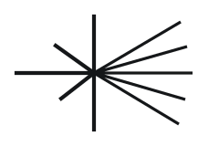
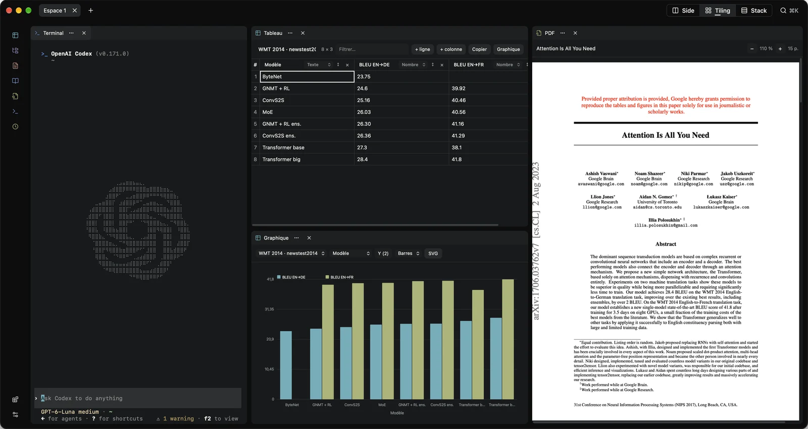

<p align="center">
  <picture>
    <source media="(prefers-color-scheme: dark)" srcset="assets/spark-symbol-light.svg">
    <source media="(prefers-color-scheme: light)" srcset="assets/spark-symbol-dark.svg">
    
  </picture>
</p>

<h1 align="center">Spark</h1>

<p align="center">
  An agentic workspace for macOS.<br>
  Your agents work in the same room as you.
</p>

<p align="center">     </p>

<p align="center">
  
</p>

Spark is a desktop workspace built around tabs. Terminals, files, PDFs, tables, web pages and
agents live side by side in one window, and share the same objects. Drag a tab to an edge to split, to the
centre to group, drag a separator to resize.

The interface is available in English, French, Spanish, German, Italian, Portuguese, Japanese
and Simplified Chinese. The language is chosen from Settings → Language and applies live.

Most agent tools put the conversation in the middle and the work at the edges. Spark does the
opposite: the workspace is the surface, and the agent plugs into it.

## Why another window

- **The tab is the unit.** A terminal, a PDF, a table and a chart can share one tab, and each
  keeps its own state. A terminal keeps its PTY session across layout changes.
- **Agents see the workspace, not a screenshot.** A local MCP server exposes fifteen tools and
  the typed actions each tile declares. No screen parsing, no computer-use heuristics.
- **Local by default.** The bridge is a Unix socket with `0600` permissions. No network port, no
  account, no cloud relay.
- **Open source.** MIT, readable end to end, one dependency list.

## What is inside

| Tile | What it does |
|---|---|
| **Terminal** | A real PTY session per tile, with agent detection and one-click MCP setup. |
| **Explorer** | A folder tree that opens a file in Markdown or a shell in the right directory. |
| **Markdown** | Editor and preview over the same document, with line-addressed agent actions. |
| **PDF** | Fetches an https link, caches it, keeps the content out of MCP. |
| **Data** | Typed tables (text, number, date) up to 2,000 rows, with charts bound to the table. |
| **OpenAlex** *(official extension)* | Search by topic, author or DOI, then open a free PDF beside your notes. |
| **Browser** | Any public page in a native view: sign-in, media, real sites. https only, downloads refused, and the page title names the tab. |

Extensions add tiles: a React view, a manifest and typed actions. They install from a registry or
a local folder, in a Store that opens over the workspace.

## Build from source

Requires macOS (the only platform for now), Node.js 22.18+, a Rust toolchain and the Xcode command line tools.

```sh
git clone https://github.com/nnnnnzo/sparkawe.git
cd sparkawe
npm install
npm run sidecar          # build the MCP bridge
npm run tauri -- dev     # run the app
```

Checks:

```sh
npm run typecheck && npm run lint && npm test
cargo test --manifest-path src-tauri/Cargo.toml --lib
```

## Connect an agent

Spark ships the `spark-mcp` bridge and writes the client configuration for you: the gear menu at
the bottom of the rail shows the exact command, and a terminal running a known agent gets a
one-click connect chip.

```json
{
  "mcpServers": {
    "spark": {
      "command": "/Applications/Spark.app/Contents/MacOS/spark-mcp"
    }
  }
}
```

The fifteen tools: `spark_brief`, `spark_tabs`, `spark_tiles`, `spark_tab_open`,
`spark_tab_close`, `spark_tab_focus`, `spark_tile_open`, `spark_tile_read`, `spark_tile_call`,
`spark_tile_close`, `spark_tile_move`, `spark_tile_resize`, `spark_undo`, `spark_redo`,
`spark_events_since`.

Any MCP client works. Claude Code, Codex, Cursor, Gemini CLI, OpenCode and Mistral Vibe are
configured by Spark; anything else only needs the bridge path.

## Status

- **macOS only, for now.** Built and tested locally. The PTY layer also targets Linux; Windows is
  not supported yet — the MCP bridge relies on a Unix socket.
- **No release artefact yet.** You build from source. Builds are unsigned and not notarised.
- **The embedded browser is macOS and Windows only for now.** On Linux it waits for an upstream
  fix to child-webview positioning (tauri#10420).
- **No update channel.** Pull the repository and rebuild.
- **Extensions are not sandboxed.** An imported package runs in the main window with the app's
  privileges. The zip's SHA-256 is checked before extraction; no signature is verified today.
- **No telemetry** in the app.

## Documentation

- [sparkawe.vercel.app/docs](https://sparkawe.vercel.app/docs/) — how it works, the MCP bridge,
  the extension SDK, the package format, the trust model (English and French).
- [`doc/`](doc/README.md) — the repository documents, in French, and the source of truth for
  every contract.
- [`brand/`](brand/) — logo, symbol and the brand guidelines.

## Contributing

Issues and pull requests are welcome. There is no CLA: contributions are accepted under the MIT
licence with a Developer Certificate of Origin sign-off — a `Signed-off-by` line in the commit.

## Licence

Code under [MIT](LICENSE), copyright 2026 nnnnnzo. The name and the logo are covered by a
separate [trademark policy](TRADEMARK.md). Third-party components are listed in
[THIRD-PARTY-NOTICES.md](THIRD-PARTY-NOTICES.md).
